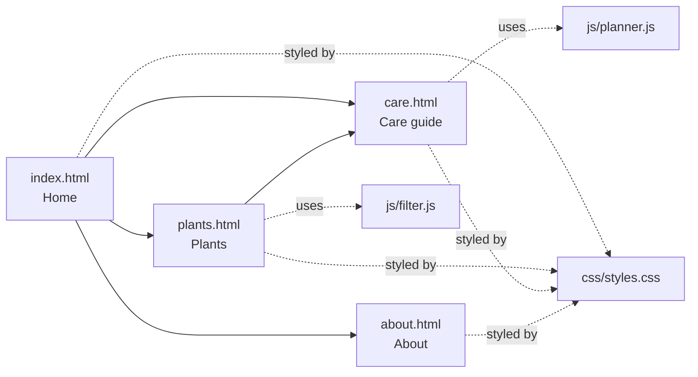

<p align="center">
  
</p>

Pocket Plants is a small static website: a guide to six easy houseplants with light, watering, and pet-safety notes. It is built with plain HTML, CSS, and a little JavaScript, and it is published with GitHub Pages.

**Live site:** `https://OWNER.github.io/REPO-NAME/` (replace `OWNER` and `REPO-NAME` with the account and repository names). The exact address is shown in the repository's **Settings**, then **Pages**. A site published privately uses a different address.

> [!IMPORTANT]
> GitHub's Code tab shows `.html` files as source text, not as web pages. The rendered site appears only at the GitHub Pages address above. Markdown files, SVG images, and Mermaid diagrams do render directly on GitHub.

## Features

- Four pages: home, plants, care guide, and about.
- A plants page with live filters for name, available light, and pet safety.
- A watering planner that calculates the next watering date.
- Light and dark color schemes that follow the system setting.
- Accessible markup: skip link, landmarks, alt text, and keyboard-friendly controls.
- No build step and no dependencies.

## Site map



## Repository tour

| Path | What it contains |
|------|------------------|
| [`index.html`](index.html), [`plants.html`](plants.html), [`care.html`](care.html), [`about.html`](about.html) | The four pages |
| [`css/`](css) | The single stylesheet, with light and dark color schemes |
| [`js/`](js) | The plant filter and the watering planner |
| [`assets/`](assets) | The logo, favicon, and six plant illustrations in SVG |
| [`scripts/check-site.mjs`](scripts/check-site.mjs) | The page check that the CI workflow runs |
| [`docs/`](docs) | [Design notes](docs/design-notes.md) with the palette and layout |
| [`.github/`](.github) | The Site check workflow, issue templates, and the pull request template |
| `.nojekyll` | An empty file that tells GitHub Pages to publish the files as they are |

## Illustrations

The plant artwork is drawn as SVG, so it displays directly in the repository as well as on the site.

| | | |
|:-:|:-:|:-:|
| <br>Pothos | <br>Snake plant | <br>Monstera |
| <br>Aloe vera | <br>Spider plant | <br>Boston fern |

## Run it locally

Open `index.html` in a browser. All links are relative, so the site works straight from disk.

## Check the pages

```bash
node scripts/check-site.mjs
```

The check needs Node 18 or newer. It reports pages that are missing a `lang` attribute or a title, images without alt text, broken local links, and absolute links that would break on a project site.

## Publish with GitHub Pages

1. Open the repository's **Settings**, then **Pages**.
2. Under **Build and deployment**, set **Source** to **Deploy from a branch**.
3. Choose the `main` branch and the `/ (root)` folder, then select **Save**.
4. Wait a few minutes, then open the address shown at the top of the Pages settings.

### Private repositories

This repository is intended to be private. The source code, issues, pull requests, and history stay visible only to invited collaborators and members.

| Plan | Pages from a private repository | Who can open the published site |
|------|---------------------------------|---------------------------------|
| GitHub Free | Not available | Not applicable |
| GitHub Pro or Team | Available | Anyone who has the address |
| GitHub Enterprise Cloud | Available | Anyone who has the address, or only people with read access to the repository when the site is published privately |

> [!WARNING]
> Publishing a site from a private repository does not make the site private. Unless the organization uses private publishing on GitHub Enterprise Cloud, everything on the site is reachable on the public internet. Keep confidential content out of the pages.

Without Pages, the pages can still be previewed by opening `index.html` in a browser. Everything else in the repository, including the README, the design notes, the SVG illustrations, and the Site check workflow, works the same in a private repository.

## Roadmap

- [x] Four pages with a shared header and footer
- [x] Plant filter and watering planner
- [x] Light and dark color schemes
- [x] Automated page check
- [ ] Add a custom 404 page
- [ ] Add more plants, such as a ZZ plant and a peace lily
- [ ] Add a print stylesheet for the care table

## Contributing and license

Guidelines are in [CONTRIBUTING.md](CONTRIBUTING.md). The project is released under the [MIT License](LICENSE).
