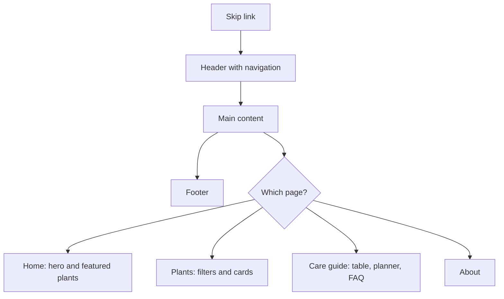

# Design notes

Reference notes for anyone changing the look of the site. All colors are CSS custom properties defined at the top of [`css/styles.css`](../css/styles.css).

## Color palette

| Token | Light mode | Dark mode | Used for |
|-------|-----------|-----------|----------|
| `--bg` | `#f6f8f4` | `#101713` | Page background |
| `--surface` | `#ffffff` | `#18221c` | Cards, header, panels |
| `--text` | `#1d2b22` | `#e6efe8` | Body text |
| `--muted` | `#53645a` | `#a8b9ae` | Secondary text |
| `--border` | `#d5ddd3` | `#2c3a31` | Dividers and outlines |
| `--accent` | `#2f7d4f` | `#6fcf97` | Buttons and active navigation |
| `--accent-strong` | `#235f3b` | `#8fe0b0` | Links and hover states |

## Layout

| Breakpoint | Behavior |
|------------|----------|
| Below 720 px | The hero stacks into one column and the navigation wraps |
| 720 px and above | The hero shows text and an illustration side by side |
| Any width | Cards fill the available width in columns of at least 260 px |

## Page structure

## Accessibility checklist

- [x] Skip link as the first focusable element
- [x] One `h1` per page, with headings in order
- [x] Alt text on every illustration, and empty alt text on decorative icons
- [x] Visible keyboard focus on links, buttons, and form fields
- [x] Text and background colors meet WCAG AA contrast in both color schemes
- [ ] Add a reduced-motion preference when animations are introduced
